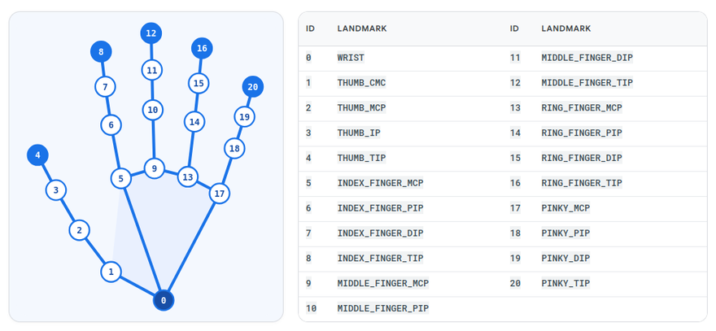
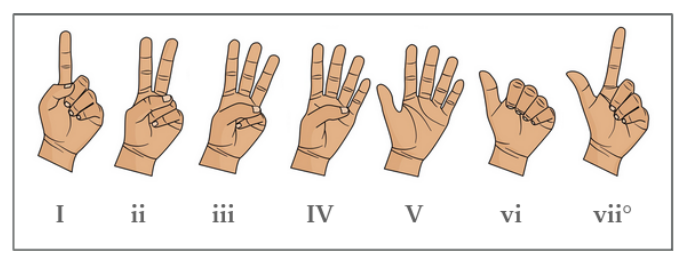
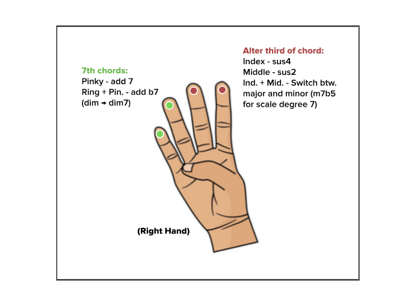

# Hand Synthesizer

## Overview

This program enables the user to make music with a webcam using computer vision. It controls a synthesizer via gesture detection, allowing the user to play different chords depending on their hand position. With the left hand, they can choose the chord to play, and with the right, they can modify this chord. The program also includes a loop controller to allow for layering and longer songs.

To create this program, we used four existing python frameworks: OpenCV, Mediapipe, Pychord, and Fluidsynth.

The program is split into modules that each handle one stage, and `main.py` connects them in a loop that runs on every webcam frame. A frame is read by OpenCV, `visuals.py` finds the hand landmarks with MediaPipe, `gestures.py` reduces them to finger patterns, `chords.py` turns those into chord notes, and `audio.py` plays them through FluidSynth. `looper.py` can record and replay the chords.

## Demo
All functions of the algorithm may not be included since the demo videos were made in parallel to development of the project.

**Tutorial for basic functions of Hand Synthesizer**

[](https://youtu.be/w4X1slxahTQ)

*[Watch on YouTube](https://youtu.be/w4X1slxahTQ)*

**Hot Cross Buns on Hand Synthesizer**

[](https://youtu.be/SwFPhwH4CE4)

*[Watch on YouTube](https://youtu.be/SwFPhwH4CE4)*

## Gesture Recognition

Mediapipe is an open-source image recognition framework created by Google, and contains built-in software for hand tracking. The program works off a pre-trained deep learning model that is trained to detect the palm area of hands. Because the palm detection model is time consuming to run, when processing video/live-streaming, the model uses the bounding box of the hand detected in the current frame to localize the hand in the next frame, reducing how often the palm detection model needs to run. Mediapipe then uses the location of the palm as an input to a secondary model that identifies the hand's structure. This structure is represented as 21 discrete points, each representing a different point on the hand, as shown below.



*Fig. 2: The 21 hand landmarks returned by MediaPipe's Hand Landmarker. Point 0 is the wrist, and points 4, 8, 12, 16, and 20 are the fingertips.*

These two models are packed into a single component, Hand Landmarker. Our program loads it from a pretrained model file, `hand_landmarker.task`, which is downloaded automatically the first time the program runs. It is created in video mode, so that an image and timestamp can be sent to the landmarker in each webcam frame, returning the 21 landmarks for each hand it finds, along with a mirror-corrected label saying whether each is a left or right hand.

The landmarker is controlled by three confidence thresholds: `min_hand_detection_confidence` (minimum confidence in reporting a new hand), `min_hand_prescence_confidence` (minimum confidence in a hand being present in the tracked region), and `min_tracking_confidence` (how well the landmarks follow the hand between frames). At the default values of 0.5 for all three, wrong gestures were detected when hands were slightly tilted, and inanimate, background objects were also falsely detected as hands. As a result, we decided to raise the detection threshold to 0.7, ensuring that false detections were minimized without making the model so strict that even real hands aren't detected.

Using the relative positioning of each of these points, our program is able to classify different hand gestures. The function `finger_states` takes in the points for a hand in a given frame, then for each finger, checks if the tip of the finger is further from the wrist than its middle joint. If it is, it returns that finger as extended. For example, if the distance between point 8 and point 0 is greater than the distance between point 6 and point 0, the index finger is extended, otherwise, it is curled. The exception of this is the thumb, which unlike the other fingers, closes to the side, rather than towards the wrist. For this, the program checks the distance to the base of the pinky rather than the wrist.

With `finger_key`, we are able to express the hand position in terms of which fingers are extended through a 5-element tuple of 0s and 1s (0s for unextended and 1s for extended) in the following order: index, middle, ring, pinky, and thumb. The `ChordHandler` class then uses this tuple to select a chord. `set_degree` uses the left hand's tuple to choose the scale degree and `set_quality` uses the right hand's to choose the chord quality.

## Playing Chords

Mediapipe also returns which hand the gesture belongs to, which we use to allow for more complex controls using both hands. The left hand determines scale degree, or which base chord in the given key to play. For example, while in the C major key, holding up 2 fingers plays the chord with its root note as the 2nd scale degree, a D minor. The corresponding gesture for each scale degree is shown below.



*Fig. 3: Left-hand gestures for each scale degree in C major.*

The right hand is optionally used to change the chord extension by modifying the third of the chord or adding 7ths. The chosen gestures give the user considerable freedom without allowing conflicts or accidental inversions (e.g. adding both a major 7th and minor 7th is very uncommon and would be best classified with a different root note).

Pressing the "k" key on the keyboard will cycle through the 12 major keys.



*Fig. 4: Right-hand gestures that modify the chord quality. The result depends on the current scale degree.*

With the base chord set from the left hand gesture, and modification from the right, we then use `get_chord` to translate these instructions into an actual chord as defined by PyChord, a library to create and modify chords. Pychord's `components_with_pitch` function then breaks the chord down into individual notes, and for each note, the `note_name_to_midi` function converts them into midi values.

To avoid undesired chords playing for a short moment (ie. if another gesture is detected briefly while transitioning gestures), each hand's gesture is smoothed briefly before being converted to music. By looking at the 5-element tuple for a given hand at a given frame and ensuring its values stay the exact same for 2 frames, we can confirm that it is a stable configuration. Until the new pattern is confirmed, the previous one stays in effect. Since most hand-tracking glitches are isolated, we decided that having a 2-frame threshold for stable classification was sufficient, especially when considering the delay that a greater valued threshold would cause. Other misreads would last several frames anyways, which would be difficult to smooth in real-time. Such sustained errors are more related to the gesture detection logic itself, which we explained in the section above.

These patterns are then transformed into chord notes with `ChordHandler` and sent into the `ChordPlayer` class to be played as real chords. This class uses the FluidSynth python library, which can play notes given a specified midi pitch value and instrument. The class's `set_chord` function calls Fluidsynth, and plays the notes at the midi values from `note_name_to_midi` to play the chord.

## Looping

The loop controller is a finite state machine with three states: idle, recording, and playing. To cycle between these, the user makes a fist with the right hand. The first fist starts recording, the second ends it and starts playback, and the third stops the loop entirely.

When the looper is recording, chords' MIDI note numbers and their timestamps (relative to when recording was initialized) are saved as tuples in the list `key_history` under the `save_chords` function. Chords are only saved as they change, so our list is not redundant and convoluted with endless tuples.

The `playback` function returns the chord that should be sounding at the current moment. It takes the time elapsed since playback began and wraps it around the length of the recording, so that time behaves like a circle; when the end of the loop is reached, the timestamp returns to the start. Time is also measured in seconds from a monotonic, internal clock instead of frames, so lagging or glitching in the camera will not affect stretch or shift the loop. In this state, live chords can also be played in conjunction with the loop on a separate MIDI channel.

## Learnings

### Technical Problems

We ran into issues with sound playback, as we realized the library we were using to modify chords, PyChord, did not actually control audio. PyChord was the best way to reference complicated chords in alignment with music theory practices, but it serves primarily as a dictionary and only returns strings. We tried building the chords based on their musical intervals using musicpy, but musicpy's infrastructure for chords is limited, and working with intervals rather than scale degrees is much more difficult for a user to control.

### Design Challenges

An interesting lesson we encountered was how to prioritize user interaction. Since this algorithm is built for accessibility and creative control, we mulled over which gestures to use so that movement was intuitive, what variety and depth of commands were reasonable to include considering the scope of our project, and how we could make our system modular enough to incite a sense of agency within the user. At first, our algorithm assigned gestures to different intervals rooted in middle C. However, we quickly realized intervals were not as appealing and sought after for use compared to basic chords, and that the gestures we were tracking (numbers 1-9 in sign language) were very difficult to make, especially for someone with limited joint control since it required isolated fingers to be bent down (ie. only the ring finger). Understanding the effects and implications of our work was very insightful to seeing how technology could impact a person's ability to pursue their interests!

### Future Work

To improve and build upon this project in the future, we could expand the features beyond chord playing and looping, such as beat-making, quantizing, and the ability to create melodic lines and bass notes. We could also improve the detection abilities, and include multiple options for gestures to perform in order to make the program more accessible.

Our experience working with Mediapipe has given us a good foundation for further projects exploring gesture or body control, such as integration with a robotic arm. Working with Pychord and Fluidsynth has given us more practice with integrating python libraries, including reviewing documentation and the application of useful functions. Approaching this project as a team, especially with the amount of asynchronous work we did, gave us practice in dividing up tasks and maintaining clear communication on that work being done.

Technology to play music using hand gestures already exists in different forms today. For example, the artist Imogen Heap created MiMU gloves to control sound, software, and visuals through hand gestures. Technology like this bridges the gap between physical instruments and digital music production, adding a unique kinesthetic element to electronic music. It can be an accessible way to create music for those who have physical impairments that may not have the fine motor control necessary to play other instruments.

## Team Contributions

### Alex

I created our gesture recognition program, the fluidsynth code for playing notes, and the code to translate pychord chords into MIDI notes that could be used by fluidsynth.

### Maddy

I designed the chord selection system and implemented it with the chord changer function.

### Irene

I implemented gesture smoothing, the loop controller, and interval playing (which was ultimately not used).

## AI Usage

AI was used for debugging purposes to diagnose errors and give hints to fixing unexpected behavior in the code. It was also used to set up the framework for MediaPipe's hand tracking algorithm and to organize our code.

## Setup

These steps assume your machine has Ubuntu with Python 3.

1. Install the system packages. FluidSynth and a SoundFont cannot be installed with pip.

   ```bash
   sudo apt install fluidsynth libfluidsynth3 fluid-soundfont-gm
   ```

2. Download the repository.

   ```bash
   git clone https://github.com/Aqazilbash/cv-project.git
   cd cv-project
   ```

3. Create and activate a virtual environment.

   ```bash
   python3 -m venv venv
   source venv/bin/activate
   ```

4. Install the Python dependencies (MediaPipe, PyChord, and pyfluidsynth).

   ```bash
   pip install -r requirements.txt
   ```

5. Run the program.

   ```bash
   python main.py
   ```

A webcam is required to run our program. The first run downloads the MediaPipe hand model (`hand_landmarker.task`), so it needs an internet connection. If there is no sound or FluidSynth reports a driver error, change `driver="pulseaudio"` to `"alsa"` in `audio.py`, and check that the SoundFont path in `make_synth` exists on your system.
